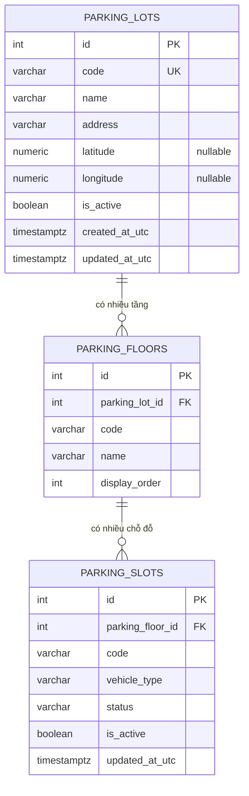
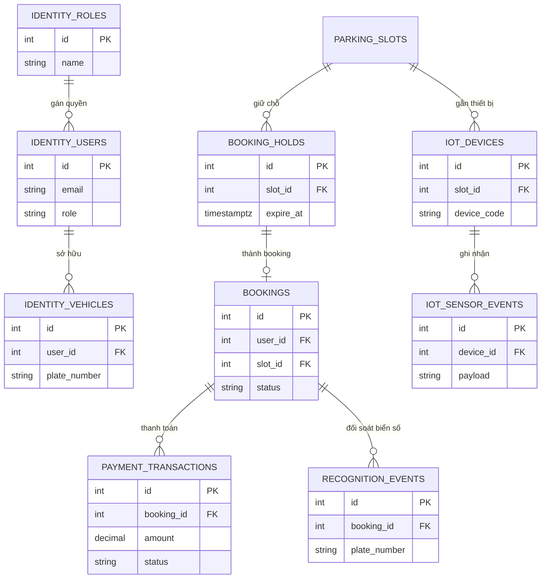

# ERD schema parking

Migration đầu tiên chỉ tạo schema `parking`. Các schema khác là định hướng, chưa tạo bảng.

## Schema hiện tại

## Khóa và ràng buộc

### parking.parking_lots

- PK: `id` (integer identity)
- Unique: `code`
- Check: `code`, `name` và `address` không rỗng
- Check: `latitude` null hoặc trong [-90, 90]
- Check: `longitude` null hoặc trong [-180, 180]
- Index: `is_active`

Latitude/Longitude để nullable vì chưa có tọa độ thật. Không seed GPS giả.

### parking.parking_floors

- PK: `id`
- FK: `parking_lot_id` → `parking_lots.id` (Restrict, không xóa bãi khi còn tầng)
- Unique: (`parking_lot_id`, `code`)
- Check: `code`/`name` không rỗng, `display_order >= 0`

Layout bản đồ chưa xác định nên chưa thêm cột layout.

### parking.parking_slots

- PK: `id`
- FK: `parking_floor_id` → `parking_floors.id` (Restrict, không xóa tầng khi còn chỗ)
- Unique: (`parking_floor_id`, `code`)
- Check `vehicle_type`: `car`, `moto`, `ev`
- Check `status`: `available`, `occupied`, `reserved`, `out_of_service`
- Index: `status`, `is_active`

Không sinh slot từ `availableSlots` của API JSON.

## Ranh giới dữ liệu

Chỉ module Parking được ghi các bảng `parking_*`. Module khác không ghi trực tiếp các bảng này.

API hiện tại:

- `GET /parking-lots` đọc JSON mẫu
- `GET /api/ParkingSlots` đọc mock trong memory

Chưa map JSON sang PostgreSQL.

## Schema dự kiến phát triển sau

Không tạo trong Migration đầu tiên.

Phụ trách dự kiến:

- `identity`, `parking`, `booking`: Phụng
- `payment`: Nam Anh
- `iot`: Thức
- `recognition`: Đức, nếu cần
- Hạ tầng dùng chung: Trí
- Kiểm thử: Danh
- REST API cho Frontend: Song
